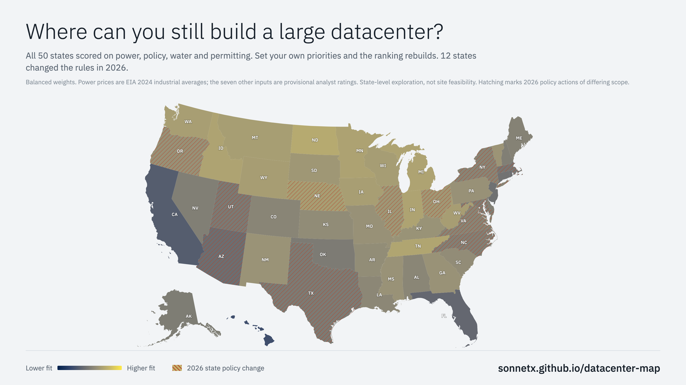

# US data center politics by state, 2026

An interactive map of where states court, pause or restrict data center development, and where towns and counties have passed moratoriums of their own. A siting model for hyperscale and AI training projects sits underneath. [Live site](https://sonnetx.github.io/datacenter-map/).

[](https://sonnetx.github.io/datacenter-map/)

The page opens on three political views of the states. State posture runs from courting to restrictive, public pushback runs from low to high, and rules in force shows the strongest datacenter-specific statewide rule that has taken effect. Dots mark about 900 local moratoriums in force and about 70 proposed ones, from the [Moratorium Nation](https://mjbommar.github.io/moratorium-data-2026/) dataset (CC BY 4.0). A findings card lists the states where these records disagree, such as courting states with many local moratoriums. Each list prints the rule that selects it.

Under Advanced analysis, pick a project size and a set of priorities, and the page ranks states on power cost, winter solar resource, grid headroom, policy, permitting, water, hazards, cooling climate and connectivity. Each state has a profile with its political record, scores, sensitivity range, local measures and sources. Hatching on the Siting fit map marks a recorded 2026 statewide policy action.

- **Political views first**: categories, not scores, for posture, pushback and rules in force, because ordinal analyst labels do not support finer distinctions. None of them changes fit or rank.
- **Local and state action apart**: county and town moratoriums draw as dots over the state colors, and each profile lists the state's most recent local measures.

- **Twelve figures of the same fifty states**: choropleth, prism map, hex cartogram, price beeswarm, factor ridgelines, coxcombs, bump chart, alluvial, hypothetical outcome plot, isotype, glyphs and an attrition band. Each note says what the figure hides.
- **Shortlist and compare**: save states from a profile or the table and read them side by side, one column each, with every factor's value bar and contribution and the most favorable cell marked in each row.
- **Profiles that explain themselves**: each state's one-rating sensitivity band names the single rating change that moves its rank furthest. Previous and Next page through the ranking without leaving the dialog.
- **Links that carry everything**: map view, size, priorities, ranking rule, price anchors, color scale, figure, shortlist and an open profile all live in the address, omitted at their defaults. Copy scenario link and Copy profile link do the rest.
- **Fixed or stretched colors**: fit is shaded on a fixed 0 to 100 scale by default so links stay comparable; Stretch to range spreads the ramp across the scenario's own extremes when the middle needs separating.
- **Dark scheme and print**: the page follows the operating system's color scheme, including every SVG and canvas figure, and prints as the map, comparison, table and methodology without the controls.
- **Open data**: CSV and JSON downloads, a Dataset schema.org record for search engines, CC BY 4.0.

Posture, pushback and the rule axes are provisional analyst classifications, and every state record cites at least one source. Local moratoriums come from Moratorium Nation, with the dataset's own status as of its update date. Electricity prices come from EIA 2024 industrial averages and solar irradiance from NASA POWER. The other seven factors are provisional analyst ratings on a 1 to 5 scale that have not been individually validated against original records. [docs/model.md](docs/model.md) describes the scoring model, project size bands, sensitivity test and scenario link format, and [docs/data.md](docs/data.md) defines the state record schema.

## Development

Validation and builds need Python 3 and Node 22 or newer.

```sh
python3 tests/validate_data.py      # check state records and local measures
python3 scripts/local_measures.py   # refresh local moratoriums from Moratorium Nation
python3 build.py                    # regenerate index.html
node --test tests/model.test.cjs    # scoring tests, run against the real model
```

Browser tests need Playwright and Chromium. Set `CHROME_PATH` to use a system Chrome instead of the Playwright download.

```sh
python3 -m pip install playwright && python3 -m playwright install chromium
python3 tests/browser.py
CHROME_PATH=/usr/bin/google-chrome python3 tests/browser.py   # or a system browser
```

The page is built from these sources; `build.py` inlines them, plus the map geometry, into a single `index.html`, which is committed because GitHub Pages serves it directly.

| File | Holds |
|---|---|
| `src/template.html` | The markup, with one placeholder per source below |
| `src/styles.css` | Styles, including the dark scheme and print rules |
| `src/model.js` | The scoring model: factors, presets, size bands, ranking, sensitivity, color scale. No DOM, so `tests/model.test.cjs` runs it as-is |
| `src/app.js` | Political map views, local moratorium layer, findings, map, priorities panel, scenario address, profiles, table, comparison card, share card, scatter |
| `src/figures.js` | The twelve figures and their rotation |
| `src/main.js` | Start-up order and the dataset download |
| `data/states.json` | The fifty state records ([schema](docs/data.md)) |
| `data/local_measures.json` | Local data center moratoriums from Moratorium Nation, projected onto the map ([schema](docs/data.md#local-moratoriums)) |
| `scripts/local_measures.py` | Downloads the Moratorium Nation inventory, keeps data center measures and checks each point against its state |

Never edit `index.html` by hand. Rerun the build after changing a source or the data, since CI fails when `index.html` is stale. `review/` holds dated review and change records, which are historical snapshots rather than live documentation.

## Contributing

Corrections should cite primary sources, identify the claims they support, and explain any rating changes. Fork the repository and open a pull request. Changes to `main` need passing CI, resolved review comments and maintainer approval, and new commits invalidate prior approval. A maintainer has to start CI for pull requests from forks.

## License

Code is MIT. The state records and written analysis are CC BY 4.0. The local moratorium data is Michael J. Bommarito's Moratorium Nation dataset, CC BY 4.0. Third-party map geometry and libraries keep their own terms. See [LICENSE](LICENSE).
